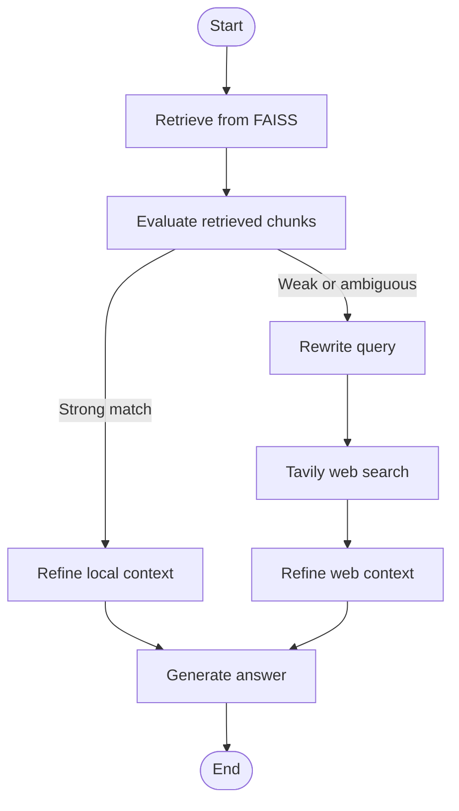

# Corrective RAG with LangChain and LangGraph

This project explores a Corrective Retrieval-Augmented Generation (RAG) workflow. It checks whether retrieved passages can answer a question, refines useful context, and uses web search when local retrieval is insufficient.

## Workflow

The notebooks build the system in stages. In the final workflow (`6_ambiguous.ipynb`):

1. **Retrieve documents** — search the local FAISS index for the four most similar chunks.
2. **Evaluate relevance** — an LLM scores each chunk from 0 to 1. Scores above `0.7` indicate a strong match; scores below `0.3` indicate weak matches; other results are treated as ambiguous.
3. **Route and refine** — a strong match uses relevant local chunks. Otherwise, the question is rewritten as a concise web query and sent to Tavily. The selected context is split into sentences and filtered for relevance to the original question.
4. **Generate an answer** — an LLM answers from the refined context and is instructed to say when the context is insufficient.



LangGraph orchestrates the workflow with shared state, nodes for retrieval, evaluation, query rewriting, search, refinement, and generation, plus conditional routing after document evaluation. The earlier evaluator notebooks include separate ambiguous-result handling; the final notebook sends every result that is not `CORRECT` to query rewriting and web search.

## Technologies

- Python and Jupyter notebooks
- LangChain and LangGraph
- Google Gemini (`gemini-3.5-flash-lite`) for evaluation and generation
- Jina embeddings (`jina-embeddings-v5-omni-nano`)
- FAISS for vector search
- Tavily for web search
- Pydantic and `python-dotenv`

## Setup

Use Python 3.10 or newer, then install the listed dependencies:

```bash
python -m venv .venv
source .venv/bin/activate  # Windows: .venv\Scripts\activate
pip install -r requirements.txt
```

Install Jupyter to open the notebooks if it is not already available:

```bash
pip install notebook
```

Create a `.env` file in the repository root with your own credentials (do not commit this file):

```dotenv
GOOGLE_API_KEY=your_google_ai_studio_key
JINA_API_KEY=your_jina_api_key
TAVILY_API_KEY=your_tavily_api_key
```

The included `faiss_db/` index is loaded by the retrieval notebooks. To rebuild it from the source PDFs, `1_basic_rag.ipynb` uses `PyPDFLoader`; install `pypdf` if needed. Its loader paths use `./documents/`, while this repository's folder is named `Documents/`. Use paths matching the actual folder name on case-sensitive systems.

## Run

Start Jupyter from the repository root:

```bash
jupyter notebook
```

Run the notebooks in order to follow the project iterations, finishing with `6_ambiguous.ipynb` for the final web-search workflow. Each notebook contains an example question and invocation.

## Project structure

```text
.
├── 1_basic_rag.ipynb
├── 2_retrival_refinement.ipynb
├── 3_retrival_evaluator.ipynb
├── 4_web_search.ipynb
├── 5_query_rewrite.ipynb
├── 6_ambiguous.ipynb
├── Documents/          # Source PDF books
├── faiss_db/           # Prebuilt FAISS index and metadata
├── requirements.txt
└── .gitignore
```

The notebooks progress from basic document Q&A through sentence filtering, relevance evaluation, web fallback, query rewriting, and the final routing workflow.
